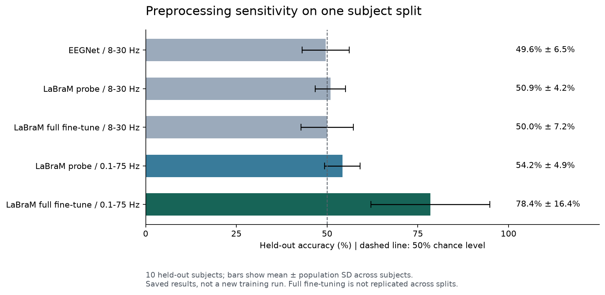
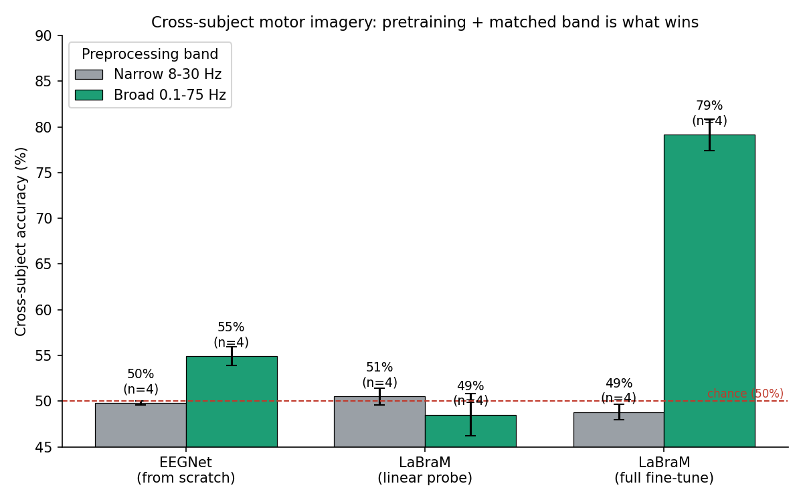
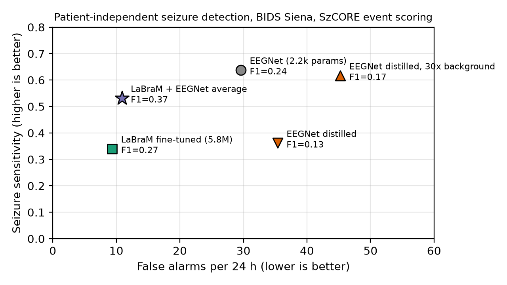

# Cross-Subject EEG Motor-Imagery Decoding

This project asks a harder question than within-subject classification: **can a model decode left- vs. right-hand motor imagery for people it never saw during training?**

Using PhysioNet EEG Motor Movement/Imagery data, I built subject-disjoint experiments comparing EEGNet with the pretrained LaBraM foundation model. The main lesson was not simply that a larger model performed better—it was that matching a pretrained model's original input distribution changed the experimental conclusion.

> 中文研究记录：[README.zh-CN.md](README.zh-CN.md)  
> Full matched-comparison notes: [FINDINGS_labram_vs_eegnet.md](FINDINGS_labram_vs_eegnet.md)

## Inspect the result in one minute

```bash
python3 scripts/summarize_results.py
```

This command uses only Python's standard library, reads the committed JSON files, and recomputes the broadband summaries from the ten per-subject results. It does not download data, install PyTorch, or train a model.



## Results at a glance

The matched comparison used separate training data, a **5-subject validation cohort**, and a **10-subject held-out test cohort**.

| Model and protocol | Held-out result |
|---|---:|
| EEGNet, 8–30 Hz | 49.6% ± 6.5% |
| LaBraM linear probe, 8–30 Hz | 50.9% ± 4.2% |
| LaBraM full fine-tune, 8–30 Hz | 50.0% ± 7.2% |
| LaBraM linear probe, 0.1–75 Hz | 54.2% ± 4.9% |
| **LaBraM full fine-tune, 0.1–75 Hz** | **78.4% ± 16.4%, kappa +0.58** |

The independent validation cohort reached approximately **72%** under the successful broadband setup. Eight of ten held-out test subjects scored between 67% and 100%, while two remained near chance.

## Replication across subject splits

The table above is one subject split (Split A); its ±16.4% is variation across the ten held-out subjects. To check whether the headline survives a different choice of subjects, I re-ran **all six configurations, including a broadband EEGNet baseline, on 4 independent subject splits** (`run_matrix_robust.sh` + `step3d_matrix.py`, results in `step3c_fullmatrix_results.json`). Values are mean ± population SD **across splits** (`python3 scripts/summarize_results.py` recomputes them):

| Model | 8–30 Hz | 0.1–75 Hz |
|---|---:|---:|
| EEGNet, end-to-end | 49.8% ± 0.3% | 54.9% ± 1.0% |
| LaBraM linear probe | 50.5% ± 0.9% | 48.5% ± 2.3% |
| **LaBraM full fine-tune** | 48.8% ± 0.8% | **79.1% ± 1.7%, kappa +0.58** |

The original 78.4% sits in the middle of this distribution. Broadband input alone helps EEGNet only slightly (+5 points), so the large gain comes from the pretrained model given its own input band.



## Remaining limitations

- Split-level variance is small, but **subject-level variance is large**: within a split, 1–2 of 10 held-out subjects remain near chance.
- Full fine-tuning reaches ~99.6% training accuracy; early stopping and the pretrained prior keep it generalizing, but overfitting is a real concern.
- Four splits is still a small replication, and all runs use one dataset and one task.

## Follow-up study: patient-independent seizure detection (SzCORE)

Does the motor-imagery result generalize to a clinical task? Same comparison on the
[BIDS Siena Scalp EEG](https://zenodo.org/records/10640762) dataset (public, de-identified; 14 patients, 47 seizures, ~141 h),
evaluated with the [SzCORE](https://arxiv.org/abs/2402.13005) protocol.

- Patient-independent 7-fold CV: 2 test, 2 validation, 10 training patients per fold.
- 19 channels (10-20, common average), 0.5–75 Hz + 50 Hz notch, 200 Hz, 4 s windows with 2 s stride.
- Event-based scoring with `timescoring` (any overlap, 30 s / 60 s tolerance, events merged within 90 s, split > 5 min).
- Threshold (0.05–0.99) and smoothing window (5–30 s) are selected on the validation patients only
  (`seizure/repostproc.py`, from saved probability traces).

| Pooled over all 14 test patients | Sensitivity | Precision | F1 (pooled) | F1 per fold | False alarms / 24 h |
|---|---:|---:|---:|---:|---:|
| EEGNet, trained from scratch (2,210 params) | **0.64** | 0.15 | 0.24 | **0.41 ± 0.29** | 29.6 |
| LaBraM, full fine-tuning (5.8M params) | 0.34 | **0.23** | **0.27** | 0.27 ± 0.19 | **9.4** |
| EEGNet distilled from LaBraM (1:5 background) | 0.36 | 0.08 | 0.13 | 0.25 ± 0.31 | 35.4 |
| EEGNet distilled, 30× teacher-labelled background | 0.62 | 0.10 | 0.17 | 0.28 ± 0.26 | 45.3 |
| **LaBraM + EEGNet probability average** | 0.53 | **0.28** | **0.37** | **0.44 ± 0.29** | 10.9 |



What this shows:

- **The pretraining advantage is task-dependent.** Alone, LaBraM is a trade-off: about 3× fewer false alarms, about half the sensitivity.
- **The two models make complementary errors.** Averaging their probabilities (weight, threshold and smoothing chosen on the validation patients; `seizure/ensemble.py`) keeps LaBraM's false-alarm rate (10.9 / 24 h) while recovering most of EEGNet's sensitivity, raising pooled F1 from 0.27 to 0.37.
- **Failures are structured.** LaBraM caught 1 of 10 seizures of the only frontal-onset patient (EEGNet 5 of 10); two temporal-lobe patients (8 seizures) were missed by both models.
- **Naive compression does not keep the advantage.** Distilling LaBraM into EEGNet (~11× faster on CPU, 5 vs. 54 ms per window) did not keep its low false-alarm rate, even with 30× more background data.
- No model here is clinically usable, and fold-to-fold variance is large with 14 patients.

An earlier run (`seizure/archive_v1/`) used class weights on top of 1:5 sampling and a single validation
patient; it was too trigger-happy (fold 0: 106 false alarms / 24 h) and was replaced by the protocol above.

Reproduce: `seizure/run_all.sh` (download BIDS Siena to `~/mne_data/BIDS_Siena` first), then
`seizure/run_distill.sh`, `seizure/run_distill_bg.sh`, `python seizure/repostproc.py EEGNet fullFT KD KDbg30`,
`python seizure/ensemble.py`, and `python seizure/make_figure.py`.

## What changed the outcome

With the conventional 8–30 Hz motor-imagery band, every method remained near chance. LaBraM was pretrained on broadband EEG; the change is consistent with sensitivity to its input distribution, and the replication matrix's broadband EEGNet baseline (54.9%) shows broadband input alone does not explain it. Restoring 0.1–75 Hz input while keeping the comparison subject-disjoint produced the large gain.

This creates a general evaluation lesson: **when transferring a pretrained model, preprocessing is part of the model contract.** A reasonable domain convention can still produce the wrong conclusion if it breaks that contract.

## Experimental design

- Dataset: PhysioNet EEG Motor Movement/Imagery
- Task: imagined left vs. right hand movement
- Inputs: 64 EEG channels, runs 4/8/12
- Split policy: subject-disjoint training, validation, and test cohorts
- Models: EEGNet and LaBraM
- LaBraM modes: frozen linear probe and full fine-tuning
- Reporting: held-out subject accuracy, variation across subjects, Cohen's kappa, validation behavior, and explicit caveats

## Technical adaptations

- Converted signal scale to microvolts to match LaBraM's expected input convention.
- Interpolated/mapped EEG channels to the pretrained model's channel representation.
- Adapted temporal embeddings for the experiment's 1,000-sample windows.
- Kept subject identities disjoint to prevent person-level leakage.

## Results and source map

| Artifact | What it contains |
| --- | --- |
| [step3_results.json](step3_results.json) | Split A: narrowband summaries, subject IDs, configuration, and per-subject values |
| [step3b_broadband_results.json](step3b_broadband_results.json) | Split A: broadband LaBraM per-subject accuracy and kappa |
| [step3c_fullmatrix_results.json](step3c_fullmatrix_results.json) | Completed replication: 6 configurations × 4 subject splits, per-split values and mean ± std |
| [step3d_matrix.py](step3d_matrix.py) / [run_matrix_robust.sh](run_matrix_robust.sh) | Process-isolated, resumable runner for the replication matrix |
| [make_figure.py](make_figure.py) | Regenerates `figure_band_x_model.png` from the replication results |
| [step3_compare.py](step3_compare.py) | Narrowband experiment |
| [step3b_broadband.py](step3b_broadband.py) | Broadband LaBraM experiment |
| [FINDINGS_labram_vs_eegnet.md](FINDINGS_labram_vs_eegnet.md) | Historical investigation notes and remaining comparisons |

These files live at the repository root, not in a `results/` directory. The historical notes include exploratory interpretations; the limitations above govern the strength of the headline result.

## Training prerequisites

The historical notes record Python 3.12, PyTorch 2.12 with MPS, and Braindecode 1.5.1. The training scripts also import NumPy, MNE, and scikit-learn. A complete original environment lock is not available, so a fresh training environment still needs compatibility validation, including `braindecode.models.InterpolatedLaBraM`.

The scripts retrieve PhysioNet EEGBCI data through MNE and the `braindecode/labram-pretrained` weights through Braindecode. Training therefore needs network access, model/data storage, and substantially more compute than inspecting saved results. Existing scripts select MPS on supported Macs and CPU otherwise; they do not automatically select CUDA.

Before training, review the script's data selection, cache paths, and output path. Several historical scripts write to `~/bci-project/`; they are retained as experiment records rather than presented as a portable one-command training pipeline. Avoid overwriting the committed result files with a new run.

## Regenerate the figure

```bash
python3 -m pip install matplotlib
python3 scripts/plot_results.py
```

The figure uses the same saved split-A artifacts as the summary command. Error bars show population standard deviation across subjects, not confidence intervals or variance across random splits.
