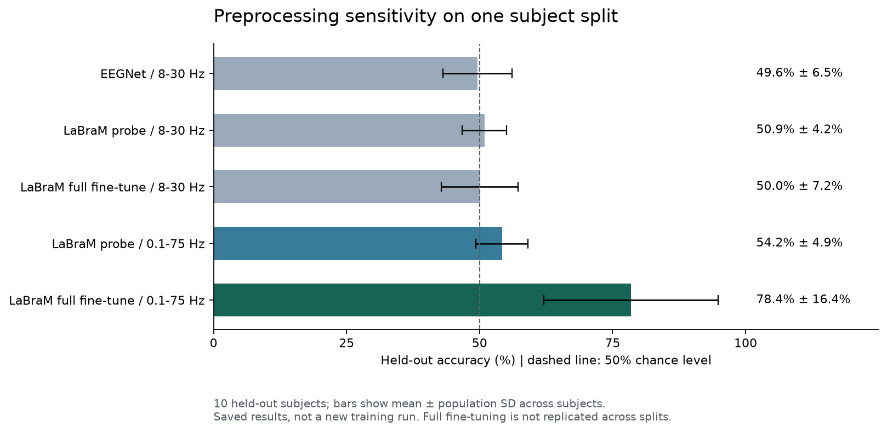
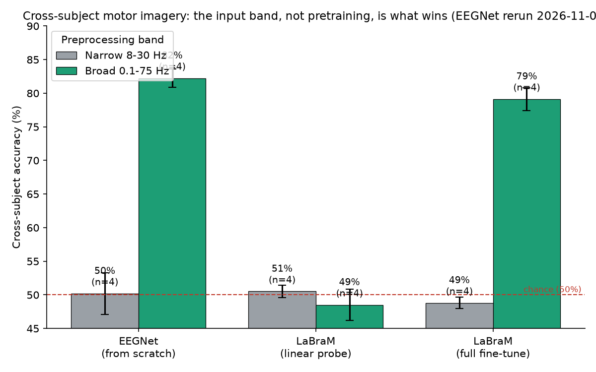
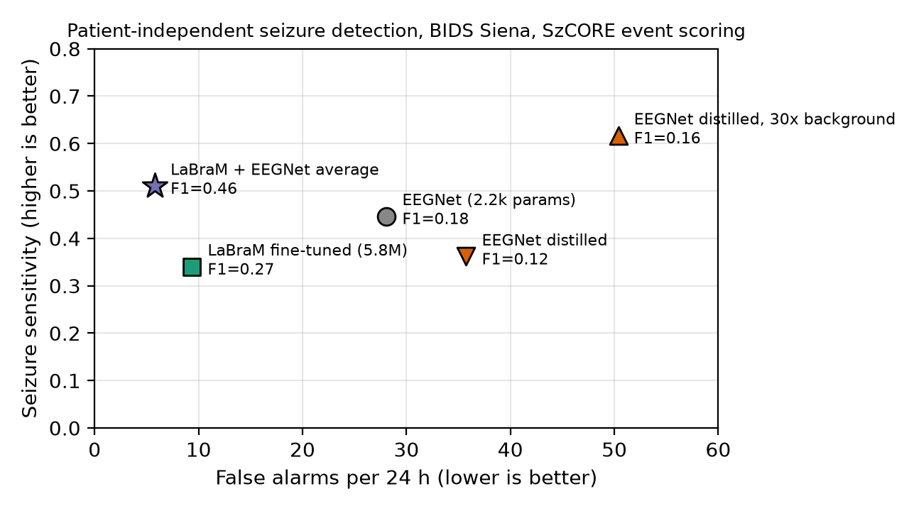
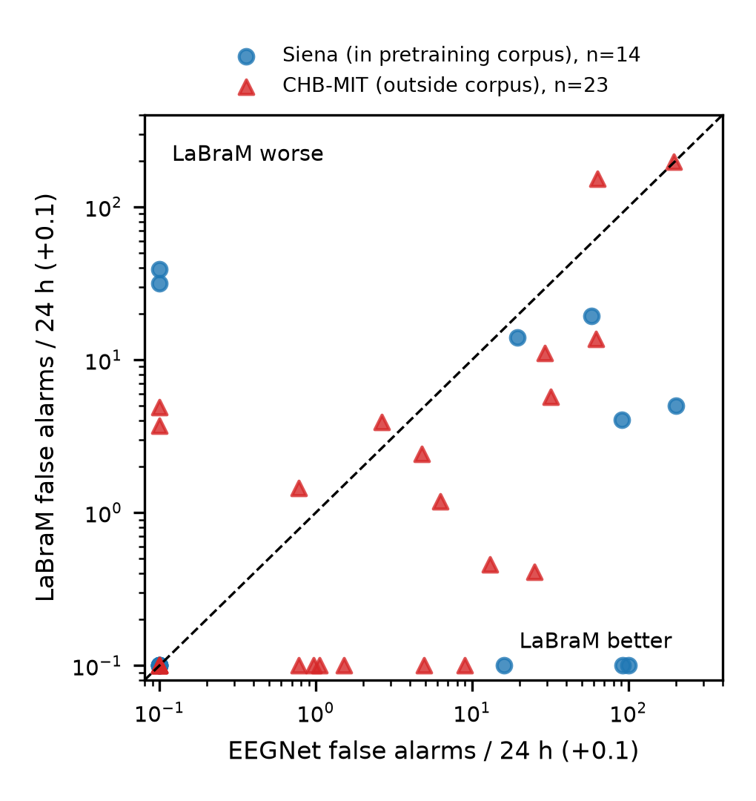

# Cross-Subject EEG Motor-Imagery Decoding

> Also in this repository: the [pretraining-overlap audit](docs/pretraining_overlap_eeg_fm.md) of 23 EEG foundation models (20 in the main table, 3 additions) plus an intracranial section, the [held-out leaderboard](docs/heldout_leaderboard.md), the [pretraining-disclosure spec](docs/pretraining_disclosure.md) for model cards, and the [NeurIPS 2026 challenge provenance sheet](docs/neurips2026_challenge_checkpoint_provenance.md).

[](https://doi.org/10.5281/zenodo.23423535)

**Technical report:** Y. Li, *Does an EEG foundation model's cross-subject advantage survive outside its pretraining corpus? Motor imagery and seizure detection*, Zenodo, 2026 (v1.1). [doi:10.5281/zenodo.23423535](https://doi.org/10.5281/zenodo.23423535)

This project asks a harder question than within-subject classification: **can a model decode left- vs. right-hand motor imagery for people it never saw during training?**

Using PhysioNet EEG Motor Movement/Imagery data, I built subject-disjoint experiments comparing EEGNet with the pretrained LaBraM foundation model. The main lesson was not simply that a larger model performed better—it was that matching a pretrained model's original input distribution changed the experimental conclusion.

**At a glance (same protocol everywhere: only the model changes, every threshold and stopping point is chosen on validation subjects):**

Both original datasets turned out to be in LaBraM's self-supervised pretraining corpus, so each study was repeated on a dataset outside it. [Details below](#held-out-replication-datasets-outside-labrams-pretraining-corpus).

| Task | In LaBraM's pretraining corpus | Outside it |
|---|---|---|
| Motor imagery, accuracy (LaBraM vs. EEGNet) | PhysioNet, 50 subj.: **79.1% vs. 82.2%** | Cho2017, 52 subj.: **65.8% vs. 70.7%** |
| Seizure detection, false alarms / 24 h (LaBraM vs. EEGNet, SzCORE) | Siena LOSO, 14 pat.: **7.7 vs. 33.7** (event F1 0.36 vs. 0.16) | CHB-MIT, 23 pat.: **10.2 vs. 16.6** (event F1 0.18 vs. 0.13) |

- **Correction (2026-11-01).** Every EEGNet number before this date was produced under a PyTorch-MPS bug (grouped convolutions return wrong values when the batch size is a multiple of 32; `docs/mps_groupconv_bug.md`). Rerun with the fix, EEGNet trained from scratch is *above* fine-tuned LaBraM on both motor-imagery datasets (82.2 vs. 79.1 and 70.7 vs. 65.8), and matches fine-tuned CBraMod (82.3 / 71.4). The earlier "LaBraM leads by 24 / 13.5 points and the lead shrinks outside the corpus" result is withdrawn. Every model drops by a similar amount from PhysioNet to Cho2017, including a CBraMod trained from random initialisation (62.4% on Cho2017), so that drop is dataset difficulty, not overlap. LaBraM still needs its 0.1–75 Hz pretraining band (8–30 Hz: 48.8% / 55.7%).
- For seizure detection LaBraM raises fewer false alarms than EEGNet on both datasets (4.4× fewer on Siena LOSO, 1.6× on CHB-MIT) at lower sensitivity; its pooled event F1 is higher on both. Per patient, its median false-alarm rate is lower on both datasets (Siena LOSO p = 0.09, CHB-MIT p = 0.09, Wilcoxon; not significant on either); on CHB-MIT two patients produce most of its false alarms because a threshold chosen on validation patients does not transfer.
- Averaging LaBraM and EEGNet helped only in the original 7-fold Siena scheme (event F1 0.43); it did not hold under leave-one-patient-out or on CHB-MIT. Distilling LaBraM into EEGNet did not keep its low false-alarm rate.

> 中文研究记录：[README.zh-CN.md](README.zh-CN.md)  
> Full matched-comparison notes: [FINDINGS_labram_vs_eegnet.md](FINDINGS_labram_vs_eegnet.md)

## Inspect the result in one minute

```bash
python3 scripts/summarize_results.py
```

This command uses only Python's standard library, reads the committed JSON files, and recomputes the broadband summaries from the ten per-subject results. It does not download data, install PyTorch, or train a model.



## Results at a glance

The matched comparison used separate training data, a **5-subject validation cohort**, and a **10-subject held-out test cohort**.

| Model and protocol | Held-out result |
|---|---:|
| EEGNet, 8–30 Hz | ~~49.6% ± 6.5%~~ (MPS bug; see the 4-split matrix below) |
| LaBraM linear probe, 8–30 Hz | 50.9% ± 4.2% |
| LaBraM full fine-tune, 8–30 Hz | 50.0% ± 7.2% |
| LaBraM linear probe, 0.1–75 Hz | 54.2% ± 4.9% |
| **LaBraM full fine-tune, 0.1–75 Hz** | **78.4% ± 16.4%, kappa +0.58** |

The independent validation cohort reached approximately **72%** under the successful broadband setup. Eight of ten held-out test subjects scored between 67% and 100%, while two remained near chance.

## Replication across subject splits

The table above is one subject split (Split A); its ±16.4% is variation across the ten held-out subjects. To check whether the headline survives a different choice of subjects, I re-ran **all six configurations, including a broadband EEGNet baseline, on 4 independent subject splits** (`run_matrix_robust.sh` + `step3d_matrix.py`, results in `step3c_fullmatrix_results.json`). Values are mean ± population SD **across splits** (`python3 scripts/summarize_results.py` recomputes them):

| Model | 8–30 Hz | 0.1–75 Hz |
|---|---:|---:|
| EEGNet, end-to-end | 50.2% ± 3.6% | **82.2% ± 1.5%** |
| LaBraM linear probe | 50.5% ± 0.9% | 48.5% ± 2.3% |
| LaBraM full fine-tune | 48.8% ± 0.8% | 79.1% ± 1.7%, kappa +0.58 |

The original 78.4% sits in the middle of LaBraM's distribution. EEGNet rows rerun 2026-11-01 after the MPS grouped-convolution fix (`docs/mps_groupconv_bug.md`): with broadband input, EEGNet trained from scratch reaches 82.2%, above fine-tuned LaBraM. The earlier reading that "broadband input alone helps EEGNet only slightly" was an artefact of the bug. The band matters for both models; the pretrained weights do not add accuracy over a from-scratch compact network here.



## Remaining limitations

- Split-level variance is small, but **subject-level variance is large**: within a split, 1–2 of 10 held-out subjects remain near chance.
- Full fine-tuning reaches ~99.6% training accuracy; early stopping and the pretrained prior keep it generalizing, but overfitting is a real concern.
- Four splits is still a small replication, and all runs use one dataset and one task.
- **Pretraining overlap:** both PhysioNet Motor Movement/Imagery and the Siena Scalp EEG Database are in LaBraM's self-supervised pretraining corpus (Jiang et al., ICLR 2024, Appendix). LaBraM has therefore seen unlabeled recordings of the held-out test subjects, which EEGNet has not. "Held-out" here means held out from fine-tuning, and the comparison favors LaBraM. After the 2026-11-01 correction LaBraM has no motor-imagery gain over EEGNet to inflate (79.1 vs. 82.2 on PhysioNet, 65.8 vs. 70.7 on Cho2017); see [the held-out replication](#held-out-replication-datasets-outside-labrams-pretraining-corpus).

## Follow-up study: patient-independent seizure detection (SzCORE)

Does the motor-imagery result generalize to a clinical task? Same comparison on the
[BIDS Siena Scalp EEG](https://zenodo.org/records/10640762) dataset (public, de-identified; 14 patients, 47 seizures, ~141 h),
evaluated with the [SzCORE](https://arxiv.org/abs/2402.13005) protocol.

- Patient-independent 7-fold CV: 2 test, 2 validation, 10 training patients per fold.
- 19 channels (10-20, common average), 0.5–75 Hz + 50 Hz notch, 200 Hz, 4 s windows with 2 s stride.
- Event-based scoring with `timescoring` (any overlap, 30 s / 60 s tolerance, events merged within 90 s, split > 5 min).
- Threshold (0.05–0.99) and smoothing window (5–30 s) are selected on the validation patients only
  (`seizure/repostproc.py`, from saved probability traces).

| Pooled over all 14 test patients | Sensitivity | Precision | F1 (pooled) | F1 per fold | False alarms / 24 h |
|---|---:|---:|---:|---:|---:|
| EEGNet, trained from scratch (2,210 params) | 0.45 | 0.11 | 0.18 | 0.27 ± 0.26 | 28.1 |
| LaBraM, full fine-tuning (5.8M params) | 0.34 | 0.23 | 0.27 | 0.27 ± 0.19 | 9.4 |
| EEGNet distilled from LaBraM (1:5 background) | 0.36 | 0.08 | 0.12 | 0.24 ± 0.28 | 35.7 |
| EEGNet distilled, 30× teacher-labelled background | **0.62** | 0.09 | 0.16 | 0.31 ± 0.24 | 50.4 |
| **LaBraM + EEGNet probability average** | 0.51 | **0.41** | **0.46** | **0.54 ± 0.28** | **5.8** |



What this shows:

- **Alone, LaBraM is a trade-off:** about 3× fewer false alarms (9.4 vs. 28.1 / 24 h) at lower sensitivity (0.34 vs. 0.45), and the higher pooled F1 (0.27 vs. 0.18). (All EEGNet rows rerun 2026-11-03 after the second, recursive MPS grouped-convolution fix; the 2026-11-01 rerun was still wrong at batch 64.)
- **The two models make complementary errors.** Averaging their probabilities (weight, threshold and smoothing chosen on the validation patients; `seizure/ensemble.py`) keeps LaBraM's false-alarm rate (5.8 / 24 h) while recovering sensitivity (0.51), raising pooled F1 from 0.27 to 0.46.
- **Failures are structured.** LaBraM caught 1 of 10 seizures of the only frontal-onset patient (EEGNet 2 of 10); two temporal-lobe patients (8 seizures) were missed by both models.
- **Naive compression does not keep the advantage.** Distilling LaBraM into EEGNet (~9× faster on CPU, 5 vs. 48 ms per window) did not keep its low false-alarm rate (35.7 and 50.4 / 24 h), even with 30× more background data.
- No model here is clinically usable, and fold-to-fold variance is large with 14 patients.

An earlier run (`seizure/archive_v1/`) used class weights on top of 1:5 sampling and a single validation
patient; it was too trigger-happy (fold 0: 106 false alarms / 24 h) and was replaced by the protocol above.

Reproduce: `seizure/run_all.sh` (download BIDS Siena to `~/mne_data/BIDS_Siena` first), then
`seizure/run_distill.sh`, `seizure/run_distill_bg.sh`, `python seizure/repostproc.py EEGNet fullFT KD KDbg30`,
`python seizure/ensemble.py`, and `python seizure/make_figure.py`.

## Held-out replication: datasets outside LaBraM's pretraining corpus

LaBraM's appendix lists both PhysioNet Motor Movement/Imagery and the Siena Scalp EEG Database among its pretraining datasets, so "held out" above means held out from fine-tuning, not unseen by the encoder. I repeated both studies, with the same code, on datasets that are not in that list (`heldout/`):

- **Motor imagery: Cho et al. 2017** (GigaDB 100295; 52 subjects, left vs. right hand, 64-channel Biosemi). Common-average reference; amplitudes were about 9× PhysioNet's, so one global constant (fixed before training) matched the median 8–30 Hz channel SD to PhysioNet. Same 4 random splits of 10 test / 5 validation subjects. `MI_DATASET=cho2017 python step3d_matrix.py ...`
- **Seizure detection: BIDS CHB-MIT** (Zenodo 10259996; 23 patients, 187 seizures, 980 h). Stored as an 18-channel bipolar montage, so EEGNet uses the bipolar channels and LaBraM places each derivation at the midpoint of its two electrodes (as braindecode does for LaBraM's own bipolar channels). 8 folds of 3 test patients, 60 Hz notch, otherwise identical. `SZ_DATASET=chbmit python seizure/szcore_siena.py ...`

| Cho2017 accuracy, mean ± SD over 4 splits | 8–30 Hz | 0.1–75 Hz |
|---|---:|---:|
| EEGNet, from scratch | 66.6% ± 1.3% | **70.7% ± 2.6%** |
| LaBraM linear probe | 51.3% ± 0.5% | 51.7% ± 0.5% |
| LaBraM full fine-tune | 55.7% ± 3.2% | 65.8% ± 2.3% |

Without the amplitude correction, LaBraM full fine-tuning reaches 66.5% ± 2.3%, so the scale choice does not matter. Results: `heldout/results_cho2017_matrix*.json`.

| Seizure detection, SzCORE, pooled | Sens. | Prec. | Event F1 | FA / 24 h |
|---|---:|---:|---:|---:|
| Siena LOSO, EEGNet | 0.45 | 0.10 | 0.16 | 33.7 |
| Siena LOSO, LaBraM | 0.43 | 0.31 | 0.36 | 7.7 |
| Siena LOSO, ensemble | 0.51 | 0.12 | 0.20 | 28.9 |
| CHB-MIT, EEGNet | 0.33 | 0.08 | 0.13 | 16.6 |
| CHB-MIT, LaBraM | 0.31 | 0.12 | 0.18 | 10.2 |
| CHB-MIT, ensemble | 0.34 | 0.10 | 0.15 | 14.5 |

Per patient (Wilcoxon signed-rank), LaBraM's median false-alarm rate is lower on Siena LOSO (0.0 vs. 8.0 / 24 h, p = 0.09; lower in 7 of 14 patients, higher in 2) and on CHB-MIT (0.4 vs. 2.5, p = 0.09; lower in 13 of 23 patients, higher in 6), but neither difference is significant, and sensitivity does not differ (p ≥ 0.19). On CHB-MIT, two patients in one fold got a LaBraM threshold of 0.4 from the validation patients and produced 197 and 153 false alarms / 24 h, which is most of its pooled total.



**Caveat:** the in-corpus and out-of-corpus datasets also differ in cohort (CHB-MIT is pediatric), montage and hardware, so the shrinkage is an upper bound on the effect of pretraining exposure, not an isolated estimate.

## What changed the outcome

With the conventional 8–30 Hz motor-imagery band, every method remained near chance on PhysioNet. Restoring 0.1–75 Hz input while keeping the comparison subject-disjoint produced the large gain, for the pretrained model and, after the 2026-11-01 correction, for EEGNet trained from scratch as well (82.2%). The band, not the pretraining, is what changed the outcome on this dataset.

This creates a general evaluation lesson: **when transferring a pretrained model, preprocessing is part of the model contract.** A reasonable domain convention can still produce the wrong conclusion if it breaks that contract.

## Experimental design

- Dataset: PhysioNet EEG Motor Movement/Imagery
- Task: imagined left vs. right hand movement
- Inputs: 64 EEG channels, runs 4/8/12
- Split policy: subject-disjoint training, validation, and test cohorts
- Models: EEGNet and LaBraM
- LaBraM modes: frozen linear probe and full fine-tuning
- Reporting: held-out subject accuracy, variation across subjects, Cohen's kappa, validation behavior, and explicit caveats

## Technical adaptations

- Converted signal scale to microvolts to match LaBraM's expected input convention.
- Interpolated/mapped EEG channels to the pretrained model's channel representation.
- Adapted temporal embeddings for the experiment's 1,000-sample windows.
- Kept subject identities disjoint to prevent person-level leakage.

## Results and source map

| Artifact | What it contains |
| --- | --- |
| [step3_results.json](step3_results.json) | Split A: narrowband summaries, subject IDs, configuration, and per-subject values |
| [step3b_broadband_results.json](step3b_broadband_results.json) | Split A: broadband LaBraM per-subject accuracy and kappa |
| [step3c_fullmatrix_results.json](step3c_fullmatrix_results.json) | Completed replication: 6 configurations × 4 subject splits, per-split values and mean ± std |
| [step3d_matrix.py](step3d_matrix.py) / [run_matrix_robust.sh](run_matrix_robust.sh) | Process-isolated, resumable runner for the replication matrix |
| [make_figure.py](make_figure.py) | Regenerates `figure_band_x_model.png` from the replication results |
| [step3_compare.py](step3_compare.py) | Narrowband experiment |
| [step3b_broadband.py](step3b_broadband.py) | Broadband LaBraM experiment |
| [FINDINGS_labram_vs_eegnet.md](FINDINGS_labram_vs_eegnet.md) | Historical investigation notes and remaining comparisons |

These files live at the repository root, not in a `results/` directory. The historical notes include exploratory interpretations; the limitations above govern the strength of the headline result.

## Training prerequisites

The historical notes record Python 3.12, PyTorch 2.12 with MPS, and Braindecode 1.5.1. The training scripts also import NumPy, MNE, and scikit-learn. A complete original environment lock is not available, so a fresh training environment still needs compatibility validation, including `braindecode.models.InterpolatedLaBraM`.

The scripts retrieve PhysioNet EEGBCI data through MNE and the `braindecode/labram-pretrained` weights through Braindecode. Training therefore needs network access, model/data storage, and substantially more compute than inspecting saved results. Existing scripts select MPS on supported Macs and CPU otherwise; they do not automatically select CUDA.

Before training, review the script's data selection, cache paths, and output path. Several historical scripts write to `~/bci-project/`; they are retained as experiment records rather than presented as a portable one-command training pipeline. Avoid overwriting the committed result files with a new run.

## Regenerate the figure

```bash
python3 -m pip install matplotlib
python3 scripts/plot_results.py
```

The figure uses the same saved split-A artifacts as the summary command. Error bars show population standard deviation across subjects, not confidence intervals or variance across random splits.
